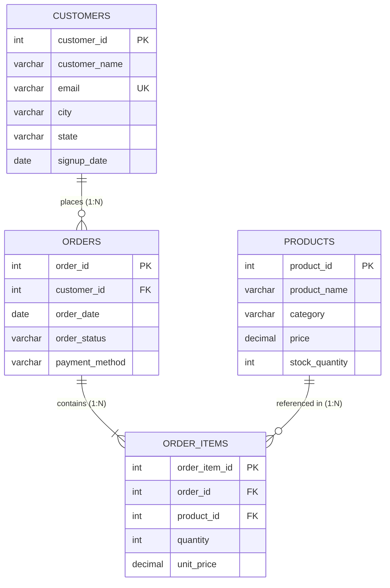

# E-Commerce Sales Analysis Using MySQL

[](https://www.mysql.com/)
[](#technology-stack)
[](#dataset-overview)
[](#project-overview)

An end-to-end, SQL-only e-commerce sales analysis project built using MySQL for a professional Data Analyst portfolio. This project encompasses relational database modeling, constraint architecture, large-scale recursive synthetic data generation (38,500 records), exploratory data analysis, advanced analytical SQL (Window Functions, CTEs), and business intelligence reporting addressing 25 core business questions and executive KPIs.

---

## Table of Contents

- [Project Overview](#project-overview)
- [Project Objectives](#project-objectives)
- [Technology Stack](#technology-stack)
- [Dataset Overview](#dataset-overview)
- [Database Schema & Architecture](#database-schema--architecture)
- [Repository File Structure](#repository-file-structure)
- [SQL Concepts Demonstrated](#sql-concepts-demonstrated)
- [Business Analysis (25 Business Questions)](#business-analysis-25-business-questions)
- [Executive Key Performance Indicators (KPIs)](#executive-key-performance-indicators-kpis)
- [Execution Instructions](#execution-instructions)
- [Data Integrity & Validation](#data-integrity--validation)

---

## Project Overview

In data analytics, SQL is the foundation for extracting, transforming, and analyzing operational business data. This repository showcases a comprehensive, production-grade e-commerce analytics project conducted entirely within **MySQL 8.0+**. 

The project models an Indian e-commerce platform and tracks transactions across customers, products, orders, and itemized receipts. It simulates a real-world enterprise environment where analytical problems must be solved using pure SQL queries without relying on external tooling or libraries.

---

## Project Objectives

The primary objective of this project is to perform deep exploratory and diagnostic analysis across key business verticals:
- **Revenue & Financial Performance**: Assess gross and net revenue streams, order values, and category contributions.
- **Customer Behavior & Lifetime Value (LTV)**: Segment customers by spend tier, order frequency, and acquisition vintage.
- **Product & Inventory Performance**: Identify top revenue drivers, volume leaders, long-tail inventory, and dead stock.
- **Geographic & Regional Dynamics**: Evaluate customer distribution, regional demand, and revenue concentration across states and cities.
- **Payment Method Adoption**: Analyze transaction volume, preference, and average basket sizes by payment channel.
- **Fulfillment & Cancellation Health**: Monitor cancellation rates and shipment conversion across the transaction lifecycle.

---

## Technology Stack

- **RDBMS**: MySQL Server 8.0+
- **Database Client**: MySQL Workbench
- **Query Language**: Structured Query Language (SQL Only)

> **Note**: This is a pure SQL project. It does not use Python, Excel, Power BI, Tableau, Streamlit, or any third-party external tools. All calculations, data generation, data transformations, window ranking, cohort-style date logic, and KPI computations are executed natively in MySQL.

---

## Dataset Overview

The dataset is synthetically generated via MySQL Recursive Common Table Expressions (CTEs) to simulate realistic multi-table relational distributions:

| Metric | Deterministic Specification |
| :--- | :--- |
| **Total Customers** | `2,000` |
| **Total Products** | `500` |
| **Total Orders** | `12,000` |
| **Total Order Items** | `24,000` (2 line items per order) |
| **Total Database Records** | `38,500` |
| **Total Generated Units** | `72,000` |
| **Order Cancellation Rate** | `10.0%` (strictly deterministic via status assignment formula) |

---

## Database Schema & Architecture

The database `ecommerce_sales_analysis` consists of 4 normalized relational tables enforced with primary keys, foreign keys, check constraints, and performance indexes.



### Table Definitions

1. **`customers`**
   - Stores user demographic and account creation details.
   - **Key Columns**: `customer_id` (PK), `customer_name`, `email` (UNIQUE), `city`, `state`, `signup_date`.
   - **Index**: `idx_customers_state` on `state`.

2. **`products`**
   - Catalog of merchandise offered across categories (Electronics, Fashion, Accessories, Home Appliances, Furniture).
   - **Key Columns**: `product_id` (PK), `product_name`, `category`, `price`, `stock_quantity`.
   - **Constraints**: `chk_product_price` (`price >= 0`), `chk_product_stock` (`stock_quantity >= 0`).

3. **`orders`**
   - Header-level order records recording transaction date, status, and payment channel.
   - **Key Columns**: `order_id` (PK), `customer_id` (FK referencing `customers`), `order_date`, `order_status`, `payment_method`.
   - **Constraints**: 
     - `chk_order_status` in (`'Completed'`, `'Pending'`, `'Cancelled'`, `'Shipped'`)
     - `chk_payment_method` in (`'UPI'`, `'Credit Card'`, `'Debit Card'`, `'Net Banking'`, `'Cash on Delivery'`, `'Wallet'`)
   - **Indexes**: `idx_orders_customer`, `idx_orders_date`, `idx_orders_status`.

4. **`order_items`**
   - Itemized line items detailing product quantities and locked unit prices at purchase time.
   - **Key Columns**: `order_item_id` (PK), `order_id` (FK referencing `orders`), `product_id` (FK referencing `products`), `quantity`, `unit_price`.
   - **Constraints**: `chk_order_item_quantity` (`quantity > 0`), `chk_order_item_price` (`unit_price >= 0`).
   - **Indexes**: `idx_order_items_order`, `idx_order_items_product`.

---

## Repository File Structure

The project is structured into 20 clean, sequential SQL scripts for clear modularity:

| File Name | Purpose & Description |
| :--- | :--- |
| `00_MASTER_ECOMMERCE_SALES_ANALYSIS.sql` | **All-in-one executable script** containing the complete project from creation to final validation. |
| `01_database_creation.sql` | Drops existing schema, initializes `ecommerce_sales_analysis`, and sets CTE recursion limits. |
| `02_table_creation.sql` | DDL script defining the 4 relational tables, data types, primary keys, and check constraints. |
| `03_constraints_indexes.sql` | DDL script defining B-tree indexes for foreign keys, order dates, and state search optimization. |
| `04_large_dataset_generation.sql` | Recursive CTE generator inserting exactly 38,500 rows across all 4 tables with realistic distributions. |
| `05_data_validation.sql` | Initial data verification script validating row counts and sampling records from each table. |
| `06_basic_sql.sql` | Foundational querying: filtering, distinct values, ranges, pattern matching, and preliminary aggregates. |
| `07_aggregate_groupby_having.sql` | Grouped aggregation, sales metrics by category and status, and conditional filtering using `HAVING`. |
| `08_joins.sql` | Multi-table joins (`INNER JOIN`, `LEFT JOIN`, `RIGHT JOIN`), orphan identification, and customer-item traversals. |
| `09_subqueries.sql` | Single-row, multi-row, and scalar subqueries comparing metrics against global and regional averages. |
| `10_ctes.sql` | Common Table Expressions structuring multi-stage revenue aggregation and modular business calculations. |
| `11_window_functions.sql` | Advanced analytical queries: ranking (`ROW_NUMBER`, `RANK`, `DENSE_RANK`), period-over-period lags, running totals, and quartiles (`NTILE`). |
| `12_date_analysis.sql` | Temporal analysis: monthly and daily sales trends, customer onboarding cohorts, and order cycle durations. |
| `13_case_expressions.sql` | Dynamic segmentation logic for customer spend brackets, product price bands, and conditional revenue reporting. |
| `14_string_functions.sql` | Text manipulation, standardization, formatting, and extraction functions. |
| `15_null_handling.sql` | Data cleaning patterns with `IS NULL`, `IFNULL`, and `COALESCE` for defensive query design. |
| `16_advanced_business_analysis.sql` | Strategic analytics: Customer Lifetime Value (CLV/LTV), category market share, and regional AOV profiling. |
| `17_business_questions.sql` | **25 structured business questions** answered with targeted, optimized SQL solutions. |
| `18_final_kpis.sql` | Dedicated executive KPI summary extracting primary organizational metrics. |
| `19_final_data_validation.sql` | Comprehensive data integrity audit: duplicate checks, foreign key integrity, null auditing, and KPI summary. |

---

## SQL Concepts Demonstrated

This project provides end-to-end demonstrations of practical SQL techniques:

- **Data Querying & Filtering**: `SELECT`, `DISTINCT`, `WHERE`, `ORDER BY`, `LIMIT`, `BETWEEN`, `IN`, `NOT IN`, `LIKE`, `AND`, `OR`, `NOT`
- **Aggregation & Summary**: `COUNT()`, `SUM()`, `AVG()`, `MIN()`, `MAX()`, `GROUP BY`, `HAVING`
- **Table Relationships**: `INNER JOIN`, `LEFT JOIN`, `RIGHT JOIN`, multi-table joins, anti-joins for unfulfilled demand
- **Subqueries**: Scalar subqueries, correlated subqueries, nested subqueries in `WHERE` and `FROM` clauses
- **Common Table Expressions (CTEs)**: Modular `WITH` clauses for clean multi-level aggregations and Recursive CTEs (`WITH RECURSIVE`) for programmatic record generation
- **Window & Analytical Functions**:
  - Ranking: `ROW_NUMBER()`, `RANK()`, `DENSE_RANK()`
  - Offset: `LAG()`, `LEAD()` for MoM revenue delta analysis
  - Distribution: `NTILE(4)` for customer quartile segmentation
  - Aggregate Windowing: `SUM() OVER (...)`, `AVG() OVER ()` for running totals and percentage-of-total calculations
- **Conditional Logic**: `CASE WHEN ... THEN ... ELSE ... END` for customer segmentation and revenue classification
- **Date & Time Operations**: `YEAR()`, `MONTH()`, `MONTHNAME()`, `DAY()`, `DAYNAME()`, `DAYOFWEEK()`, `DATE_FORMAT()`, `DATEDIFF()`, `TIMESTAMPDIFF()`
- **String Functions**: `CONCAT()`, `UPPER()`, `LOWER()`, `TRIM()`, `LEFT()`, `RIGHT()`, `SUBSTRING()`, `REPLACE()`, `LPAD()`
- **Data Hygiene & Null Handling**: `IS NULL`, `IS NOT NULL`, `IFNULL()`, `COALESCE()`
- **Data Definition & Optimization**: Schema DDL, `CHECK` constraints, `FOREIGN KEY ... REFERENCES`, and performance B-Tree indexing

---

## Business Analysis (25 Business Questions)

File `17_business_questions.sql` resolves 25 core business questions encountered in real-world retail and e-commerce analytics:

| # | Question / Analysis Focus | SQL Concept Applied |
| :---: | :--- | :--- |
| **Q1** | What is the total realized net revenue across all completed/shipped orders? | `SUM()`, `JOIN`, `WHERE` |
| **Q2** | Who are the top 10 customers ranked by lifetime spend? | `GROUP BY`, `ORDER BY DESC`, `LIMIT 10` |
| **Q3** | What are the top 10 revenue-generating products in the catalog? | Multi-table `JOIN`, `GROUP BY`, `LIMIT` |
| **Q4** | Which product category generates the highest total sales? | `SUM()`, `GROUP BY`, `ORDER BY DESC LIMIT 1` |
| **Q5** | Which state yields the highest sales revenue? | Geographic aggregation, `JOIN`, `LIMIT 1` |
| **Q6** | What is the month-over-month revenue trend across the operational timeline? | `DATE_FORMAT()`, `GROUP BY`, chronological sort |
| **Q7** | What is the most frequently chosen payment method? | `COUNT(*)`, `GROUP BY`, `LIMIT 1` |
| **Q8** | Are there any products in the catalog that have recorded zero sales? | Anti-join with `LEFT JOIN ... WHERE ... IS NULL` |
| **Q9** | Are there any registered customers who have never placed an order? | Anti-join with `LEFT JOIN ... WHERE ... IS NULL` |
| **Q10** | What is the platform-wide Average Order Value (AOV)? | `SUM(revenue) / COUNT(DISTINCT order_id)` |
| **Q11** | How many total physical product units have been successfully sold? | `SUM(quantity)` with status filter |
| **Q12** | Which customers have placed the highest number of discrete orders? | `COUNT(order_id)`, `GROUP BY`, `LIMIT 10` |
| **Q13** | What is the platform's order cancellation rate percentage? | Boolean sum conditional calculation |
| **Q14** | What percentage of total orders have reached successful completion? | Boolean sum conditional calculation |
| **Q15** | Which category accounts for the highest physical volume of units sold? | `SUM(quantity)`, `GROUP BY category` |
| **Q16** | What are the top 10 cities with the largest concentration of registered customers? | Demographic `COUNT(*)`, `LIMIT 10` |
| **Q17** | Which day of the week experiences the peak volume of customer orders? | `DAYNAME()`, `DAYOFWEEK()`, `COUNT(*)` |
| **Q18** | What is the single highest-value order placed on the platform and who placed it? | Order-level aggregation, customer join, `LIMIT 1` |
| **Q19** | What is the average listing price of products within each category? | `ROUND(AVG(price), 2)`, `GROUP BY category` |
| **Q20** | Which customers have spent strictly more than the platform average customer spend? | CTE with nested `AVG()` subquery filter |
| **Q21** | What is the single best-selling product measured by quantity of units sold? | `SUM(quantity)`, `GROUP BY product_id`, `LIMIT 1` |
| **Q22** | Which calendar month represents the company's highest grossing sales period? | `DATE_FORMAT()`, `ORDER BY revenue DESC LIMIT 1` |
| **Q23** | Which payment channel is responsible for generating the highest total revenue? | Payment breakdown, `SUM()`, `LIMIT 1` |
| **Q24** | Which state demonstrates the highest Average Order Value (AOV)? | Regional AOV formula, `ORDER BY AOV DESC LIMIT 1` |
| **Q25** | Who are the top 3 spending customers in every individual state? | CTE + `DENSE_RANK() OVER (PARTITION BY state)` |

---

## Executive Key Performance Indicators (KPIs)

File `18_final_kpis.sql` extracts the primary operational and financial metrics needed for business dashboards and executive reporting:

1. **Total Customers**: Count of unique registered customer accounts (`2,000`).
2. **Total Products**: Count of unique active catalog SKUs (`500`).
3. **Total Orders**: Total transaction headers recorded (`12,000`).
4. **Total Order Items**: Itemized receipt entries created (`24,000`).
5. **Total Revenue**: Aggregate monetary value realized across all `Completed` and `Shipped` transactions.
6. **Average Order Value (AOV)**: Mean financial realization per valid order.
7. **Total Units Sold**: Gross physical inventory count fulfilled (`Completed` and `Shipped`).
8. **Best-Selling Product**: Top individual SKU measured by unit volume.
9. **Best-Selling Category**: Leading category measured by total unit throughput.
10. **Highest-Spending Customer**: Top customer by cumulative gross spend.
11. **Best Sales Month**: Highest-grossing calendar month.
12. **Most Popular Payment Method**: Predominant customer payment method by transaction count.
13. **Best-Performing State**: Top regional market by total gross sales.
14. **Cancellation Rate**: Deterministic cancellation percentage (`10.0%`).

*(Dynamic revenue and spending totals are generated on execution to preserve data reproducibility).*

---

## Execution Instructions

### Prerequisites
- Install **MySQL Server 8.0 or newer**.
- Install **MySQL Workbench** (or any preferred SQL client such as DBeaver).

### Option 1: Quick Setup (Master Script)
The simplest way to run the entire project end-to-end:

1. Open **MySQL Workbench** and connect to your local MySQL instance.
2. Open the file:
   ```text
   00_MASTER_ECOMMERCE_SALES_ANALYSIS.sql
   ```
3. Execute the entire script (**Query -> Execute (All or Selection)** or `Ctrl + Shift + Enter`).
4. The master script will:
   - Create and initialize the `ecommerce_sales_analysis` database.
   - Configure session recursion parameters (`cte_max_recursion_depth = 20000`).
   - Create all 4 tables with primary keys, foreign keys, and constraints.
   - Build performance indexes.
   - Synthesize and insert all **38,500 records**.
   - Execute all exploratory queries, CTEs, window functions, business questions, and KPI queries.

---

### Option 2: Modular Section-by-Section Execution
To study each analytical layer step-by-step:

#### Phase 1: Database Setup & DDL
1. Run `01_database_creation.sql` to initialize the database and recursion depth.
2. Run `02_table_creation.sql` to create `customers`, `products`, `orders`, and `order_items`.
3. Run `03_constraints_indexes.sql` to build indexes for optimized querying.

#### Phase 2: Data Generation & Verification
4. Run `04_large_dataset_generation.sql` to generate and populate the 38,500 records.
5. Run `05_data_validation.sql` to verify record counts (2,000 customers, 500 products, 12,000 orders, 24,000 order items).

#### Phase 3: Progressive SQL Analysis
6. Run `06_basic_sql.sql` through `15_null_handling.sql` sequentially to explore:
   - Basic selection, ranges, and patterns (`06`)
   - Group-level aggregations and `HAVING` filters (`07`)
   - Table joins and orphan identification (`08`)
   - Subquery logic (`09`)
   - CTE workflows (`10`)
   - Advanced Window Functions (`ROW_NUMBER`, `RANK`, `DENSE_RANK`, `LAG`, `LEAD`, `NTILE`) (`11`)
   - Temporal and cohort date logic (`12`)
   - Conditional segmentation via `CASE` expressions (`13`)
   - String manipulation and text parsing (`14`)
   - Missing data handling (`15`)

#### Phase 4: Business Insights & Strategy
7. Run `16_advanced_business_analysis.sql` for Customer Lifetime Value (CLV), market share, and regional trends.
8. Run `17_business_questions.sql` to evaluate all 25 specific business questions.
9. Run `18_final_kpis.sql` to generate the executive KPI snapshot.

#### Phase 5: Audit & Validation
10. Run `19_final_data_validation.sql` to perform an exhaustive audit verifying:
    - Zero duplicate primary keys.
    - Zero orphan foreign key records.
    - Zero null values in critical fields.
    - Full compliance with business rules and constraints.

---

## Data Integrity & Validation

To ensure production-grade data quality, `19_final_data_validation.sql` implements automated audit checks:

- **Primary Key Uniqueness**: Verifies zero duplicate entries in `customer_id`, `product_id`, and `order_id`.
- **Foreign Key Referencing**: Confirms that 100% of foreign keys in `orders` and `order_items` resolve to parent rows.
- **Null Value Auditing**: Verifies zero unexpected `NULL` occurrences across critical columns.
- **Domain Constraint Enforcement**: Ensures non-negative prices, positive order quantities, valid order statuses, and approved payment methods.

---

## License

This project is licensed under the MIT License - see the LICENSE file for details.
